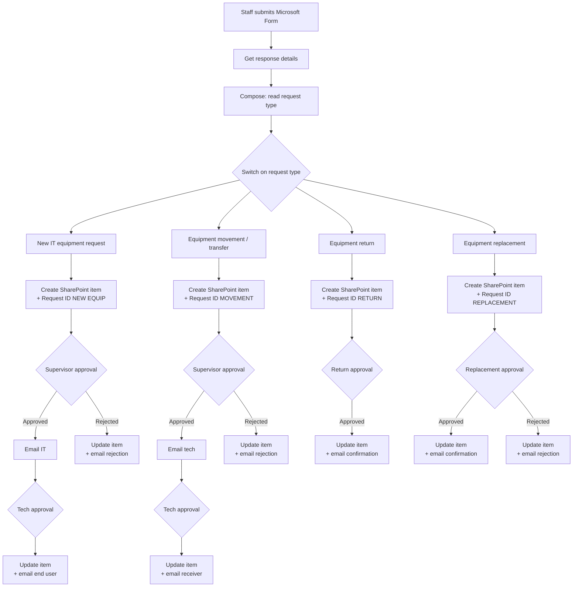
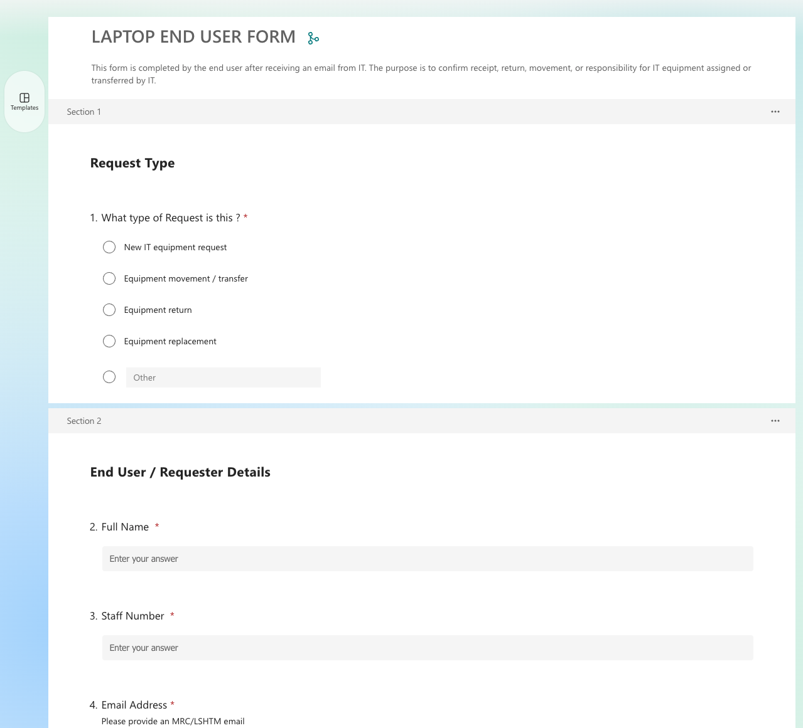

# it-it-asset-lifecycle-automation
End-to-end laptop lifecycle automation with Microsoft Forms, Power Automate and SharePoint
# IT Asset Lifecycle Automation

End-to-end automation of the laptop lifecycle (new issue, transfer, replacement and return) built with **Microsoft Forms, Power Automate, SharePoint Online, Approvals and Outlook**.

Built and run in production at a multi-site research organisation in Uganda, supporting 500+ IT assets across three sites.

> All names, emails, URLs and IDs in this repository have been replaced with placeholders. Screenshots are anonymised.

---

## The problem

Laptop requests were handled by email and tracked by hand:

- Requests arrived in different formats by email, phone and walk-in, with key details often missing.
- Approvals were chased manually, so requests stalled with no visibility.
- Technicians recorded serial numbers and asset tags separately, so the asset register drifted out of date.
- Answering "who has which laptop?" meant searching inboxes and spreadsheets.

With 500+ devices across three sites, this created a steady stream of manual work for IT and slow answers for staff and management.

## The solution

A single request form feeds an automated workflow that routes approvals, notifies the right people and keeps one SharePoint list as the source of truth for every request and asset.

**Request types covered:** new issue · transfer between users · replacement · return

### How the flow works

One Microsoft Form triggers the flow. A **Switch** on the request type sends each submission down its own branch, and every branch logs to SharePoint, generates a Request ID and runs an approval before anything is issued or moved.



1. **Trigger:** a staff member submits the Microsoft Form and chooses one of four request types.
2. **Route:** Power Automate reads the response and a Switch sends it to the matching branch.
3. **Log:** each branch creates an item in its own SharePoint list and generates a typed Request ID (NEW EQUIP, MOVEMENT, RETURN, REPLACEMENT).
4. **Approve:** new equipment and transfers go through **two-stage approval**: the supervisor first, then an IT technician. Returns and replacements need a single approval.
5. **Update and notify:** every outcome is written back to SharePoint, and Outlook emails go to IT, the requester or the receiving staff member.
6. **Rejections:** a rejected request updates the record and emails the people involved, so nothing waits silently.

## Screenshots

| Step | Screenshot |
| --- | --- |
| Request form |  |
| Flow overview |  |
| SharePoint tracking list |  |
| Approval email |  |
| Technician capture |  |

## Results

- **One source of truth:** every request, approval and device assignment is recorded against a Request ID in SharePoint.
- **No more approval chasing:** approvals are routed and recorded automatically.
- **Accurate asset register:** serial numbers and asset tags are captured at the point of issue for 500+ devices.
- **Faster answers:** IT can see who holds which laptop, and its history, from one list instead of inboxes.
- [Add a number if you have one, e.g. "Reduced laptop-request emails to IT by about X per month" or "Cut average request turnaround from X days to Y."]

## How I used AI

I used **Claude** as a design and debugging partner while building this flow:

- **Designing the logic:** I described the four request types and the approval rules, and used Claude to work out the branching structure (conditions and switch cases) and the SharePoint list columns needed to track each request.
- **Debugging:** [Describe one real failing step, e.g. "The flow failed when matching the technician's capture to the original request because the Request ID came through as text in one step and as a number in another. Claude helped me trace the error from the run history and fix it with a type conversion in the filter query."]
- **Speed:** using AI shortened both build time and troubleshooting, so I could spend more time testing with real users.

## Repository contents

```
it-asset-lifecycle-automation/
├── README.md
├── IT-Asset-Lifecycle-Flow.zip   # Exported Power Automate package (sanitised)
└── screenshots/
    ├── 01-request-form.png
    ├── 02-flow-overview.png
    ├── 03-sharepoint-list.png
    ├── 04-approval.png
    └── 05-technician-capture.png
```

### Importing the flow

1. In Power Automate, go to **My flows → Import → Import Package (Legacy)**.
2. Upload `IT-Asset-Lifecycle-Flow.zip`.
3. Map the connections (Microsoft Forms, SharePoint, Approvals, Office 365 Outlook) to your own accounts.
4. Point the flow at your own form and SharePoint list.

## Tools used

- Microsoft Power Automate (cloud flows, conditions, approvals)
- Microsoft Forms
- SharePoint Online (lists)
- Standard Approvals connector
- Office 365 Outlook
- Claude (AI-assisted design and debugging)

---

**Author:** Getrude Amodoi, Workflow Automation & Systems Integration
[LinkedIn](https://www.linkedin.com/in/your-profile) · [GitHub](https://github.com/your-username)
